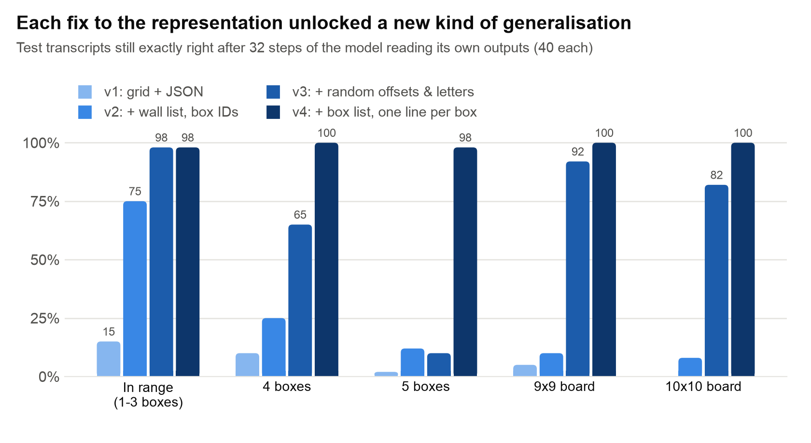

# Sokoban World Model: teaching a small LLM to push boxes

Code for the blog post **[“Can language models learn consequences?”]([LINK-TO-BLOG-POST](https://abhayshukla.substack.com/p/can-language-models-learn-consequences))**: a build log of fine-tuning a 0.6B language model to predict Sokoban's consequences, inspired by Meta FAIR's [Code World Model](https://arxiv.org/abs/2510.02387).

Every notebook is self-contained, generates its own data with an exact Sokoban solver, and runs on a **free Kaggle T4 GPU**.



## What's in here

| Blog section | Notebook | What it does | Kaggle time | Needs as input |
|---|---|---|---|---|
| Round 1: physics vs strategy | [`sokoban_cwm`](notebooks/sokoban_cwm.ipynb) | One model learns dynamics, value and policy (full-board text); planning with every combination of real/learned dynamics and heuristic/learned value | ~4 h | – |
| Does policy/value help physics? | [`sokoban_cwm_ablation`](notebooks/sokoban_cwm_ablation.ipynb) | Dynamics-only vs + policy vs + value arms on 10k physics rows, tested on bigger boards and more boxes | ~3.5 h (1 seed) | – |
| v2: walls + box IDs | [`sokoban_cwm_transcript`](notebooks/sokoban_cwm_transcript.ipynb) | Self-fed transcript model: JSON object states, `WALLS` list, box IDs; error categories (follows own path, recovers, …) | ~1.1 h | – |
| v3: augmentation | [`sokoban_cwm_transcript_v3`](notebooks/sokoban_cwm_transcript_v3.ipynb) | Random coordinate offsets and box letters in training, 2 epochs | ~2 h | – |
| v4: box list + object lines (**best model**) | [`sokoban_cwm_transcript_v4`](notebooks/sokoban_cwm_transcript_v4.ipynb) | `BOXES` header and one line per object; trains on 1-4 boxes, tests up to 6 | ~2.3 h | – |
| Recovery, hand-made errors (v5) | [`sokoban_cwm_transcript_v5`](notebooks/sokoban_cwm_transcript_v5.ipynb) | Recovery training from injected corruptions, plus a forced-error probe | ~2.6 h | v4 output (probe baseline) |
| Recovery, the model's own errors (v6) | [`sokoban_cwm_transcript_v6`](notebooks/sokoban_cwm_transcript_v6.ipynb) | Recovery training from v4's own most plausible errors (beam search), v4 continuing its own path | ~3.7 h | v4 output (**required**) |
| Is text the problem? | [`sokoban_compare_llm_cnn`](notebooks/sokoban_compare_llm_cnn.ipynb) | v2 LLM vs a translation-invariant grid CNN on identical episodes, including a shifted-board test | ~1.1 h | v2 output (its `ckpt/`) |

All test sets from v2 onwards are regenerated identically from fixed seeds (each notebook prints a fingerprint), so results compare across versions.

**About “v1”:** the blog's v1 (JSON objects without the `WALLS` line, boxes as a sorted list) was an earlier state of the v2 notebook rather than a separate file. Its differences: no `WALLS` line, no box IDs, no `after_impossible` category, and 60 test episodes per set instead of 40.

## Running on Kaggle

1. **File → Import Notebook**, and upload a notebook from `notebooks/`.
2. Settings: **Accelerator → GPU T4 x2** (one GPU is used), **Internet → On** (to download `Qwen/Qwen3-0.6B-Base`).
3. **Save Version → Save & Run All (Commit)**. It runs headless for up to 12 hours.
4. Outputs land in `/kaggle/working`: the trained checkpoint `ckpt/` (saved *before* evaluation), CSVs of every evaluated step, and figures.

For notebooks that need another run's output, attach that notebook's output with **Add Input**. The checkpoint is found automatically under `/kaggle/input/**/ckpt`. To re-run only the evaluation of a trained model, set `CFG["resume_from"]` to its `ckpt/` path.

## Running locally (smoke test)

Every notebook has a tiny CPU mode that exercises the whole pipeline with a random-init model in a few minutes. The accuracy numbers will be meaningless; it only checks the plumbing.

```bash
pip install -r requirements.txt
SOKOBAN_SMOKE=1 python src/sokoban_cwm_transcript_v4.py
```

## Editing

The notebooks are generated from the `# %%`-cell scripts in `src/`. Edit the script, then rebuild:

```bash
python src/build_notebook.py sokoban_cwm_transcript_v4   # one notebook
python src/build_notebook.py --all                        # all of them
```

## Headline results

Share of 40 held-out test transcripts still exactly right after the model reads its own outputs for 32 steps:

| Test set | v2 | v3 | v4 | v5 | v6 |
|---|---|---|---|---|---|
| In range (6-8 boards, 1-3 boxes) | 75% | 98% | **98%** | 48% | 42% |
| 8×8, 4 boxes | 25% | 65% | **100%** | 50% | 42% |
| 8×8, 5 boxes | 12% | 10% | **98%** | 50% | 38% |
| 9×9 | 10% | 92% | **100%** | 57% | 52% |
| 10×10 | 8% | 82% | **100%** | 52% | 42% |
| 8×8, 6 boxes | – | – | **80%** | 38% | 25% |

The blog post walks through why each version changed what it did.

## Things that will bite you on a T4

These are already handled in the notebooks:

- **bf16 checkpoints:** recent `transformers` loads models in their saved dtype (bf16 for Qwen3), but a T4 has no bf16. The notebooks force fp32 weights with fp16 autocast.
- **Optimizer memory after training:** the LR scheduler keeps a reference to the optimizer, so the notebooks delete both before evaluating.
- **Vocabulary-sized logits:** when most tokens are targets, the loss is computed in chunks of 512 positions.
- **KV-cache memory in long rollouts:** generation is batched by total tokens, not by count.

## Figures

`figures/` holds the blog's charts and diagrams, as PNG plus SVG source.
